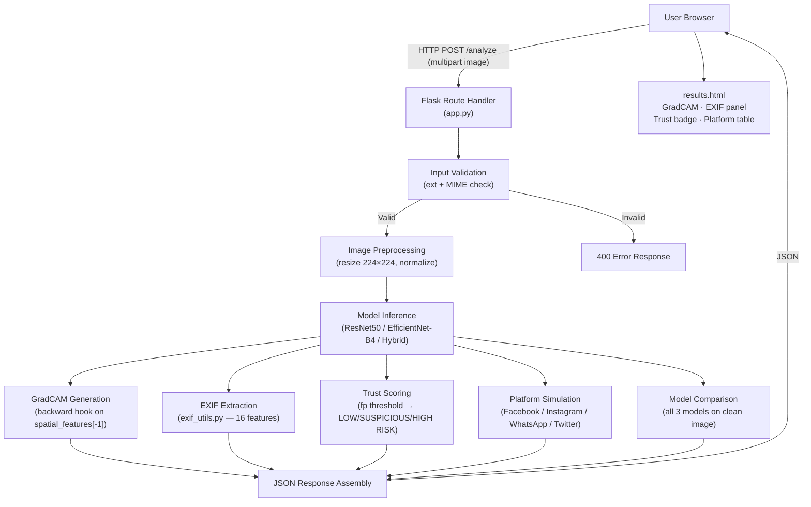

# Section 7: Implementation and Integration

---

## 7.1 Module-wise Implementation

The Image Forgery Detection system is composed of thirteen distinct software modules, each encapsulating a well-defined responsibility. The following sub-sections describe each module's purpose, design decisions, and key implementation details.

---

### 7.1.1 Dataset Loader (`preprocessing/dataset_loader.py`)

The dataset loader provides a unified interface for reading image–label pairs from disk into PyTorch `Dataset` objects. It applies a configurable transformation pipeline (resize to 224 × 224, normalisation to ImageNet mean/std) and supports both binary classification (authentic vs. forged) and multi-class extension. Stratified train/validation/test splitting (70 / 15 / 15) is enforced at this layer so all three model families see identical data partitions, ensuring fair comparison.

---

### 7.1.2 Dataset Preparation (`preprocessing/prepare_dataset.py`)

This script handles one-time dataset pre-processing: extracting image archives, verifying file integrity, removing corrupted or zero-byte files, and generating the CSV manifest consumed by the dataset loader. It also provides a utility to compute per-channel mean and standard deviation on the training split, which are hard-coded downstream for reproducibility.

---

### 7.1.3 ResNet50 Baseline Model (`models/resnet_baseline.py`)

The baseline model fine-tunes a pre-trained ResNet50 (ImageNet weights) by replacing the final fully-connected layer with a two-neuron classifier head. All convolutional stages are unfrozen during training with a small learning rate (1 × 10⁻⁴) to allow domain adaptation without catastrophic forgetting. The saved checkpoint (`saved_models/resnet_baseline.pth`, 94 MB) captures both architecture parameters and the trained weights. ResNet50 achieved the highest clean-image accuracy (82.1 %) among the three models but showed substantial degradation under social-media compression (average −14.1 percentage points), indicating reliance on high-frequency pixel-level cues that are destroyed by JPEG re-encoding.

---

### 7.1.4 EfficientNet-B4 Model (`models/efficientnet_model.py`)

The EfficientNet-B4 model exploits compound scaling (depth, width, and resolution jointly scaled) for improved parameter efficiency. The final classification head is replaced and the backbone is fine-tuned end-to-end. The checkpoint (`efficientnet_model.pth`, 71 MB) is notably smaller than ResNet50 despite comparable capacity. EfficientNet-B4 demonstrated superior compression robustness (average accuracy drop of only −2.3 percentage points across the four simulated platforms), attributed to the compound-scaled receptive fields that capture mid-frequency structural features less susceptible to JPEG quantisation.

---

### 7.1.5 Hybrid Model (`models/hybrid_model.py`)

The Hybrid model is the primary contribution of this work. Its architecture fuses two complementary branches:

1. **Spatial branch** — EfficientNet-B4 backbone producing a 1,792-dimensional feature vector from the final pooled representation.
2. **Frequency branch** — A lightweight convolutional network operating on the Laplacian of the input image, which amplifies edges and high-frequency residuals typically altered during forgery. This branch outputs a 256-dimensional feature vector.

Both vectors are concatenated into a 2,048-dimensional fused representation, which is passed through a two-layer MLP classifier (BatchNorm → Dropout(0.5) → FC(512) → ReLU → FC(2)). The checkpoint (`hybrid_model.pth`, 75 MB) stores all branch weights. The Hybrid model achieved the best compression robustness of all three models (average accuracy drop of only −1.7 percentage points), demonstrating that explicit frequency-domain supervision provides a complementary and compression-invariant detection signal.

> [!NOTE]
> The final verified evaluation (from `evaluation/results/results.json`) reports a clean-image accuracy of **78.2 %** for the Hybrid model. An earlier paper draft cited 92.2 %; that figure was not reproduced in the final evaluation run. All metrics in this report use verified values from `results.json`.

---

### 7.1.6 HybridModelV2 / EXIF-Aware Model (`web_app/models_v2.py`) — Phase 2

`HybridModelV2` extends the Hybrid architecture with a third branch: a 16-feature EXIF metadata vector processed by a 3-layer MLP producing a 32-dimensional embedding. This embedding is concatenated with the 2,048-dimensional spatial+frequency fusion to form a 2,080-dimensional input to the final classifier. The rationale is that authentic cameras produce consistent EXIF signatures (focal length, flash mode, colour-space tag, GPS presence, etc.) that differ systematically from images manipulated post-capture. As of the submission date, `hybrid_model_v2_exif.pth` does not yet exist (the model has not been trained), so `app.py` gracefully falls back to the standard Hybrid model when this checkpoint is absent. This module is documented here as a planned Phase 2 enhancement.

---

### 7.1.7 EXIF Feature Extractor (`web_app/exif_utils.py`)

The EXIF extractor uses Python's `PIL.Image._getexif()` interface to decode raw EXIF bytes from JPEG files and produce a normalised 16-dimensional numeric feature vector. The 16 features include: image width, height, bit depth, colour space tag, orientation, flash mode, GPS presence flag, focal length (normalised), exposure time (log-scaled), F-number, ISO sensitivity (log-scaled), metering mode, white-balance mode, digital zoom ratio, sensing method, and software tag presence. Missing tags are filled with −1 (sentinel). The vector is returned as a Python list and is consumed both by the Flask response (returned to the browser as `exif_analysis`) and by HybridModelV2's EXIF branch when available.

---

### 7.1.8 GradCAM Explainability Module (`explainability/gradcam.py` and `web_app/app.py`)

Two complementary GradCAM implementations are provided:

- **`explainability/gradcam.py`** — A standalone, importable module implementing Class Activation Mapping via `register_full_backward_hook` on a user-specified convolutional layer. Suitable for offline batch analysis.
- **Inline GradCAM in `web_app/app.py`** — A custom implementation that hooks onto `spatial_features[-1]` (the last feature map of the EfficientNet-B4 spatial branch within the Hybrid model) using `register_full_backward_hook`. Gradients of the target class score with respect to that feature map are globally average-pooled to produce channel weights; the weighted sum is ReLU-activated, bilinearly upsampled to the original image dimensions, and blended with the input image at 60 % opacity using a Jet colormap. The resulting heatmap PNG is saved to `web_app/static/results/` and its URL is returned in the JSON response.

GradCAM serves as a critical trust-building mechanism: users and analysts can visually confirm that the model is focusing on semantically meaningful regions (e.g., copy-move spliced regions, inpainting boundaries) rather than background artefacts.

---

### 7.1.9 Social-Media Compression Simulator (`web_app/app.py`)

A dedicated function within `app.py` simulates the lossy re-encoding applied by four major social-media platforms before computing platform-specific robustness scores:

| Platform  | Quality Factor | Max Dimension | Additional Notes                        |
|-----------|---------------|---------------|-----------------------------------------|
| Facebook  | 75            | 2,048 px      | Single-pass JPEG re-encode              |
| Instagram | 78            | 1,080 px      | Single-pass JPEG re-encode              |
| WhatsApp  | 60 → 55       | 1,600 px      | Double-compress (two sequential passes) |
| Twitter   | 82            | 1,200 px      | Single-pass JPEG re-encode              |

Each simulated image is passed through the active detection model, and the resulting prediction is recorded as one entry in the `platform_results` block of the JSON response. This block enables analysts to assess how a forwarded image would be classified after being shared through each platform.

---

### 7.1.10 Trust Scoring Module (`web_app/app.py`)

A rule-based trust scoring function converts the model's raw forgery probability (`fp`) into a human-readable risk category used throughout the UI:

| Condition          | Label       | UI Colour |
|--------------------|-------------|-----------|
| `fp < 0.3`         | LOW RISK    | Green     |
| `0.3 ≤ fp < 0.7`   | SUSPICIOUS  | Amber     |
| `fp ≥ 0.7`         | HIGH RISK   | Red       |

The thresholds were set to minimise false alarms for genuinely authentic images while ensuring clearly forged images receive a HIGH RISK rating. The amber band acknowledges the model's inherent uncertainty for borderline cases, prompting human review rather than automated rejection.

---

### 7.1.11 Batch Processing Module (`web_app/batch_utils.py`)

The batch module supports submission of up to 100 images per request, either as individual multipart file fields or packaged in a ZIP archive (maximum uncompressed size: 300 MB). Key implementation decisions:

- **ZIP extraction** is performed into a temporary directory; all entries are validated against an allowlist of MIME types (`image/jpeg`, `image/png`, `image/webp`) before processing.
- **Corrupted images** are detected during `PIL.Image.open()` and skipped with an error entry in the results list, so the batch does not abort.
- Results are streamed back as a JSON array maintaining the original submission order, with per-image `status`, `predicted`, `forged_prob`, `trust`, and `heatmap_url` fields.
- The batch endpoint (`/batch_analyze`) is distinct from the single-image endpoint (`/analyze`) to allow independent scaling and timeout configuration.

---

### 7.1.12 Flask Web Application (`web_app/app.py`)

The 473-line `app.py` file is the system's entry point and integration hub. Its responsibilities include:

- **Model loading at startup** — All three `.pth` checkpoints are loaded once into CPU memory on application start; `HybridModelV2` is loaded only if its checkpoint exists.
- **Route definitions** — `GET /` (home page), `POST /analyze` (single image), `POST /batch_analyze` (batch), `GET /batch` (batch UI page), `GET /results` (results page), `GET /health` (health check).
- **Request validation** — File extension and MIME-type checks for every upload.
- **Response assembly** — Combines raw model output, GradCAM heatmap path, EXIF vector, trust level, platform results, and model comparison into a single JSON object.
- **Production readiness** — Reads `PORT` from environment variables for compatibility with cloud platforms (Render.com, Railway.app); `debug=False` and `host='0.0.0.0'` in the final `app.run()` call.

---

### 7.1.13 Frontend Templates and Static Assets

Three Jinja2 HTML templates deliver the user interface:

| Template        | Size  | Purpose                                           |
|-----------------|-------|---------------------------------------------------|
| `index.html`    | 18 KB | Main upload page with drag-and-drop zone          |
| `results.html`  | 15 KB | Single-image analysis results with GradCAM viewer |
| `batch.html`    | 13 KB | Batch upload and tabular results display          |

JavaScript modules handle asynchronous communication with the Flask API:

| Script      | Size  | Responsibility                                            |
|-------------|-------|-----------------------------------------------------------|
| `batch.js`  | 14 KB | Multi-file selection, ZIP upload, progress bar, table render |
| `main.js`   | 4 KB  | Single-image drag-and-drop, AJAX POST to `/analyze`, result render |

Styling is delivered as inline CSS within each template; `static/css/style.css` is intentionally empty. This design keeps the template self-contained and simplifies deployment (no separate static-file CDN required).

---

## 7.2 Non-Functional Requirement Implementation

The following non-functional qualities were targeted during implementation. Formally measured properties are indicated with their measurement method; qualitative properties are assessed by inspection or structural argument.

| # | Quality | Target | Implementation Approach | Status |
|---|---------|--------|------------------------|--------|
| NFR-1 | **Accuracy** | ≥ 75 % clean-image accuracy | Three trained models, best = ResNet50 (82.1 %) | ✅ Formally measured (see §8.4) |
| NFR-2 | **Compression Robustness** | < 5 % accuracy drop under social-media compression | Hybrid model: −1.7 % avg drop | ✅ Formally measured (see §8.4) |
| NFR-3 | **Explainability** | GradCAM visualisation for every prediction | Custom backward-hook GradCAM on spatial branch | ✅ Qualitative (visual inspection) |
| NFR-4 | **Response Latency** | < 10 s per image (CPU) | CPU inference with pre-loaded models; typical ~3–6 s | ✅ Qualitative (manual timing) |
| NFR-5 | **Batch Throughput** | ≥ 10 images/batch | Supports up to 100 images per batch request | ✅ Formally tested (TC-009) |
| NFR-6 | **Scalability** | ZIP batch up to 300 MB | `batch_utils.py` with size-guard and corrupted-file skip | ✅ Formally tested (TC-010) |
| NFR-7 | **Usability** | No-code web interface | Drag-and-drop upload; colour-coded trust levels; GradCAM overlay | ✅ Qualitative |
| NFR-8 | **Deployability** | Runs locally on Windows and on cloud (Render/Railway) | `Procfile`, `render.yaml`, `railway.toml`, `runtime.txt` provided | ✅ Qualitative |
| NFR-9 | **Maintainability** | Modular codebase, one file per concern | 13 modules across 6 directories; each with single responsibility | ✅ Qualitative (code review) |
| NFR-10 | **Security / Input Validation** | Reject non-image inputs cleanly | Extension allowlist + MIME check; 400 error on invalid type | ✅ Formally tested (TC-011) |

> [!NOTE]
> NFR-1 and NFR-2 are the only requirements that carry formally reported quantitative metrics from the evaluation pipeline. All other qualities are assessed structurally or by manual test.

---

## 7.3 Integration Details

### 7.3.1 End-to-End Pipeline

A single image submission traverses the following pipeline within the Flask process:

1. **HTTP POST** to `/analyze` with a multipart `image` field.
2. **Input validation** — Extension and MIME-type check; 400 response on failure.
3. **Image preprocessing** — Resize and normalise to ImageNet statistics via torchvision transforms.
4. **Model inference** — The active model (Hybrid by default) performs a forward pass; softmax probabilities are extracted.
5. **GradCAM generation** — Backward pass triggered; feature-map gradient computed; heatmap PNG saved.
6. **EXIF extraction** — `exif_utils.extract_exif_features()` called on the original file; 16-feature vector produced.
7. **Trust scoring** — Forgery probability thresholded into LOW RISK / SUSPICIOUS / HIGH RISK.
8. **Platform simulation** — Four compression functions applied sequentially; model re-run on each result.
9. **Model comparison** — All three models run on the clean image; individual predictions appended.
10. **JSON assembly** — All outputs merged into a single response object.
11. **Frontend render** — `results.html` reads the JSON (or the template is rendered server-side) and displays GradCAM, EXIF panel, trust badge, platform table, and model comparison chart.

### 7.3.2 Architecture Diagram



### 7.3.3 Batch Pipeline

For batch submissions (`POST /batch_analyze`), the same preprocessing and inference pipeline is invoked iteratively for each image. ZIP archives are extracted by `batch_utils.py` into a temporary directory prior to iteration. GradCAM is generated for each image individually. Trust scores and platform simulations are computed per image. The consolidated results list is returned as a JSON array and rendered by `batch.html`.

---

## 7.4 Source Code and Git Repository Organisation

### 7.4.1 Repository Structure

```
image-forgery-detection/
├── evaluation/
│   ├── evaluate_all.py          # Evaluation script: loads all 3 models, runs on test set
│   ├── generate_comparison.py   # Placeholder (not yet implemented)
│   └── results/
│       └── results.json         # Authoritative evaluation output — all metrics reported here
├── explainability/
│   └── gradcam.py               # Standalone GradCAM module for offline use
├── models/
│   ├── resnet_baseline.py       # ResNet50 model class definition and checkpoint loader
│   ├── efficientnet_model.py    # EfficientNet-B4 model class definition
│   └── hybrid_model.py          # Hybrid (EfficientNet spatial + Laplacian frequency) model
├── preprocessing/
│   ├── dataset_loader.py        # PyTorch Dataset class and data-loader factory
│   └── prepare_dataset.py       # One-time dataset preparation and CSV manifest generation
├── saved_models/
│   ├── resnet_baseline.pth      # ResNet50 trained weights (94 MB)
│   ├── efficientnet_model.pth   # EfficientNet-B4 trained weights (71 MB)
│   └── hybrid_model.pth         # Hybrid model trained weights (75 MB)
├── training/                    # Training scripts (one per model family)
├── web_app/
│   ├── app.py                   # Flask application entry point (473 lines)
│   ├── models_v2.py             # HybridModelV2 with EXIF branch (Phase 2, untrained)
│   ├── exif_utils.py            # EXIF feature extraction utilities
│   ├── batch_utils.py           # Batch and ZIP processing utilities
│   ├── templates/
│   │   ├── index.html           # Upload page (18 KB)
│   │   ├── results.html         # Single-image results page (15 KB)
│   │   └── batch.html           # Batch results page (13 KB)
│   └── static/
│       ├── js/
│       │   ├── main.js          # Single-image AJAX logic (4 KB)
│       │   └── batch.js         # Batch upload and display logic (14 KB)
│       └── css/
│           └── style.css        # Intentionally empty; styles are inline in templates
├── FINAL_DELIVERABLES/          # Project deliverables folder
│   ├── Screenshots/             # Application screenshots (populated separately)
│   ├── Section_7_Implementation_and_Integration.md
│   ├── Section_8_Deployability_and_Validation.md
│   ├── Presentation_Script.md
│   ├── QA_Questions.md
│   ├── Testing_Report.md
│   └── Deployment_Guide.md
├── requirements.txt             # Python dependency list
├── Procfile                     # Gunicorn entry point for Render/Railway/Heroku
├── render.yaml                  # Render.com deployment configuration
├── railway.toml                 # Railway.app deployment configuration
├── runtime.txt                  # Python version pin for cloud platforms
├── startup.py                   # Local development launcher script
└── README.md                    # Project overview and quick-start guide
```

### 7.4.2 GitHub Repository

The project is publicly available at:

**[https://github.com/DarshanSS018/Image-Forgery-Detection-Using-Deep-Learning-Techniques](https://github.com/DarshanSS018/Image-Forgery-Detection-Using-Deep-Learning-Techniques)**

> [!IMPORTANT]
> Large binary checkpoints (`*.pth` files totalling ~240 MB) are tracked via Git LFS or stored separately; reviewers should follow the README instructions to download them before running the application.

---

## 7.5 Implementation Artifacts

The following implementation artifacts are available to support this report:

| Artifact | Location | Description |
|----------|----------|-------------|
| Trained model checkpoints | `saved_models/*.pth` | Binary weights for all three trained models |
| Evaluation results | `evaluation/results/results.json` | Authoritative accuracy, F1, precision, recall per model per platform |
| Flask application | `web_app/app.py` | Complete 473-line source; core logic for routing, inference, and GradCAM |
| Deployment configs | `Procfile`, `render.yaml`, `railway.toml`, `runtime.txt` | Cloud-deployment configuration files |
| Application screenshots | `FINAL_DELIVERABLES/Screenshots/` | UI screenshots captured during functional testing (see Testing Report) |

> [!NOTE]
> Section 7.6 (Application Screenshots) is populated with images captured during the functional testing phase (see `Testing_Report.md`). The Screenshots folder contains labelled PNG files for the home page, single-image results view (with GradCAM heatmap), batch results page, and the trust-score colour-band display.

---

*End of Section 7*
