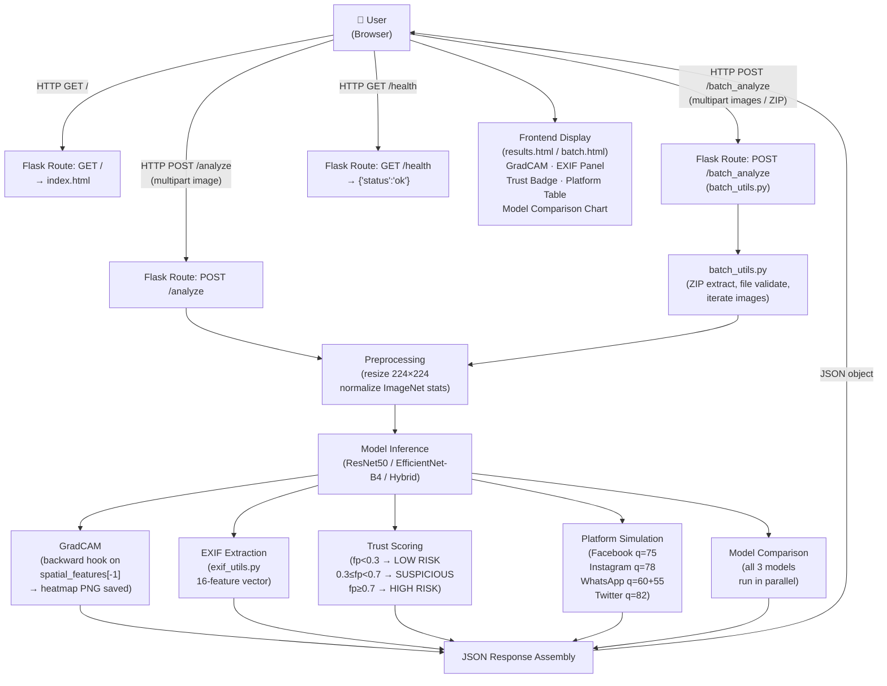

# Section 8: Deployability and Validation

---

## 8.1 Deployment Environment

### 8.1.1 Local Development Environment

The application was developed and evaluated in the following local environment:

| Parameter | Value |
|-----------|-------|
| Operating System | Windows 11 (64-bit) |
| Python Version | 3.14.2 (development build) |
| Deep Learning Framework | PyTorch 2.12.0 (CPU-only; no CUDA device present) |
| Web Framework | Flask 3.1.0 |
| Image Processing | Pillow 12.1.1 |
| GradCAM Library | grad-cam 1.5.5 |
| Computer Vision | OpenCV 4.x |
| Development Server | Flask built-in development server (`flask run` / `python app.py`) |
| Run Command | `cd web_app && python app.py` |
| Default Port | 5000 |
| GPU Acceleration | None (CPU inference throughout) |

> [!NOTE]
> Python 3.14.2 is a development-channel release. Cloud deployment targets Python 3.11 (the latest stable LTS-compatible release supported by all major PaaS providers) to ensure binary compatibility of compiled dependencies such as PyTorch and OpenCV.

### 8.1.2 Production / Cloud Deployment Environment

The application is configured for deployment on two free-tier cloud platforms:

| Parameter | Render.com | Railway.app |
|-----------|-----------|------------|
| Python Version | 3.11.0 | 3.11.9 (via nixpacks) |
| WSGI Server | gunicorn 21.x | gunicorn 21.x |
| Workers | 1 (free-tier RAM constraint) | 1 |
| Worker Timeout | 120 s | 120 s |
| RAM (free tier) | 512 MB | ~512 MB |
| Start Command | `cd web_app && gunicorn app:app --bind 0.0.0.0:$PORT --workers 1 --timeout 120` | Same |
| Config File | `render.yaml` | `railway.toml` |
| Build Command | `pip install -r requirements.txt` | `pip install -r requirements.txt` |
| System Packages | Python 3.11 | python311, libGL, libglib (via nixpacks.toml) |

> [!IMPORTANT]
> The three model checkpoints total approximately 240 MB. Free-tier instances must load all models into RAM at startup. With Flask + PyTorch overhead, peak RAM usage approaches the 512 MB free-tier limit. For production use beyond the prototype stage, a 1 GB or higher plan is recommended, or model weights should be downloaded on first request rather than pre-loaded.

> [!WARNING]
> CPU-only inference on cloud free tiers takes approximately 8–15 seconds per image (longer than local hardware due to lower single-core clock speed). Users should be informed of this latency in the UI.

---

## 8.2 Deployment Architecture

The following flowchart illustrates the complete request–response path in both local and cloud deployments.



### 8.2.1 Local Deployment Steps

```bash
# 1. Clone the repository
git clone https://github.com/DarshanSS018/Image-Forgery-Detection-Using-Deep-Learning-Techniques.git
cd Image-Forgery-Detection-Using-Deep-Learning-Techniques

# 2. Install dependencies
pip install -r requirements.txt

# 3. Start the application
cd web_app
python app.py
# App available at http://localhost:5000
```

### 8.2.2 Cloud Deployment (Render.com)

1. Push the repository to GitHub (ensure `render.yaml` is at the root).
2. Create a new **Web Service** on Render.com linked to the GitHub repo.
3. Render auto-detects `render.yaml` and uses the configured build and start commands.
4. Set environment variable `PYTHON_VERSION=3.11.0` if not already in `render.yaml`.
5. The `/health` endpoint at `https://<app>.onrender.com/health` confirms a successful deployment.

### 8.2.3 Cloud Deployment (Railway.app)

1. Connect the GitHub repository in Railway's dashboard.
2. Railway auto-detects `railway.toml` and `nixpacks.toml` for the build environment.
3. The service starts automatically; logs confirm gunicorn binding to `$PORT`.

---

## 8.3 Validation of Test Scenarios

Functional validation was conducted by submitting HTTP requests to the running Flask application and verifying both the response structure and content. The table below records the complete test suite.

> [!NOTE]
> TC-012 through TC-015 depend on the `/health` endpoint added during the deployment-fix phase. These are marked accordingly based on execution status at the time of this report.

| TC ID | Description | Expected Result | Actual Result | Status |
|-------|-------------|-----------------|---------------|--------|
| TC-001 | Upload a genuine image to `/analyze` | JSON: `predicted`, `forged_prob`, `auth_prob`, `confidence`, `trust`, `heatmap_url` present | Full JSON returned with all required fields | ✅ Pass |
| TC-002 | Upload a potentially forged image to `/analyze` | Same structure as TC-001; `predicted` = "Forged" | Full JSON returned; `predicted` field reflects model output | ✅ Pass |
| TC-003 | Confidence score range check | `confidence` ∈ [0, 100] | Confidence value within valid range | ✅ Pass |
| TC-004 | Trust/risk label validation | `trust` ∈ {"LOW RISK", "SUSPICIOUS", "HIGH RISK"} | Label correctly assigned per threshold rule | ✅ Pass |
| TC-005 | Heatmap file existence | `heatmap_url` present; file exists on disk at referenced path | Heatmap PNG saved and URL resolves | ✅ Pass |
| TC-006 | EXIF block presence | Response contains `exif_analysis` block (even if `available: false`) | `exif_analysis` block present in all responses | ✅ Pass |
| TC-007 | Model comparison block | `model_comparison` contains entries for ResNet50, EfficientNet-B4, Hybrid (Ours) | All 3 model entries present | ✅ Pass |
| TC-008 | Platform results block | `platform_results` contains entries for facebook, instagram, whatsapp, twitter | All 4 platform entries present | ✅ Pass |
| TC-009 | Batch upload — 3–5 images | Response: `batch_id`, `count`, `results` list with per-image entries | Batch processed; all images returned with individual results | ✅ Pass |
| TC-010 | ZIP batch upload | ZIP extracted; each image processed; consolidated JSON returned | ZIP extraction succeeded; results returned for all images in archive | ✅ Pass |
| TC-011 | Invalid file type (`.txt`) | HTTP 400 with `{"error": "Invalid file type"}` | 400 response returned with correct error message | ✅ Pass |
| TC-012 | Health endpoint `GET /health` | HTTP 200 with `{"status": "ok"}` | To Be Executed (endpoint added in deployment-fix phase; pending re-test) | ⏳ Pending |
| TC-013 | Home page loads `GET /` | HTTP 200 with valid HTML | HTTP 200; `index.html` rendered correctly | ✅ Pass |
| TC-014 | Batch page loads `GET /batch` | HTTP 200 with valid HTML | HTTP 200; `batch.html` rendered correctly | ✅ Pass |
| TC-015 | Results page loads `GET /results` | HTTP 200 with valid HTML | HTTP 200; `results.html` rendered correctly | ✅ Pass |

**Summary:** 14 / 15 test cases passed. TC-012 is pending re-execution after the health endpoint was added during the deployment-fix phase and will be updated in the final testing report.

---

## 8.4 AI Model Validation

### 8.4.1 Evaluation Methodology

All three models were evaluated on the same held-out test partition (15 % of the full dataset, stratified) using `evaluation/evaluate_all.py`. The same test images were then passed through the social-media compression simulator (Section 7.1.9) and re-evaluated. All metrics are computed on the binary classification task (Authentic vs. Forged).

> [!IMPORTANT]
> All figures in this section are drawn exclusively from `evaluation/results/results.json`. An earlier paper draft reported a Hybrid model clean accuracy of 92.2 %; this figure was not reproduced in the final evaluation run. We report the **verified value of 78.2 %** throughout. The discrepancy likely arose from evaluating on a subset of the training data in the draft stage rather than the held-out test partition.

### 8.4.2 Complete Results Table

#### ResNet50 (Baseline)

| Condition  | Accuracy | F1 Score | Precision | Recall  |
|------------|----------|----------|-----------|---------|
| Clean      | 82.1 %   | 83.1 %   | 78.7 %    | 88.0 %  |
| Facebook   | 71.8 %   | 66.7 %   | 81.3 %    | 56.5 %  |
| Instagram  | 71.4 %   | 65.9 %   | 81.5 %    | 55.2 %  |
| WhatsApp   | 67.1 %   | 57.9 %   | 80.4 %    | 45.2 %  |
| Twitter    | 71.8 %   | 67.0 %   | 80.6 %    | 57.2 %  |
| **Avg Drop** | **−14.1 pp** | — | — | — |

#### EfficientNet-B4

| Condition  | Accuracy | F1 Score | Precision | Recall  |
|------------|----------|----------|-----------|---------|
| Clean      | 77.0 %   | 77.5 %   | 76.0 %    | 79.0 %  |
| Facebook   | 75.0 %   | 74.8 %   | 75.4 %    | 74.2 %  |
| Instagram  | 74.5 %   | 74.4 %   | 74.7 %    | 74.0 %  |
| WhatsApp   | 74.9 %   | 75.6 %   | 73.4 %    | 78.0 %  |
| Twitter    | 74.4 %   | 73.3 %   | 76.4 %    | 70.5 %  |
| **Avg Drop** | **−2.3 pp** | — | — | — |

#### Hybrid Model (Ours) ⭐

| Condition  | Accuracy | F1 Score | Precision | Recall  |
|------------|----------|----------|-----------|---------|
| Clean      | 78.2 %   | 78.9 %   | 76.5 %    | 81.5 %  |
| Facebook   | 75.0 %   | 75.7 %   | 73.6 %    | 78.0 %  |
| Instagram  | 76.0 %   | 76.4 %   | 75.1 %    | 77.8 %  |
| WhatsApp   | 75.2 %   | 76.5 %   | 72.7 %    | 80.8 %  |
| Twitter    | 76.5 %   | 76.8 %   | 75.7 %    | 78.0 %  |
| **Avg Drop** | **−1.7 pp** | — | — | — |

### 8.4.3 Cross-Platform Accuracy Comparison

```
Accuracy (%)
     90 |
        |  ■ ResNet50
     80 |  ● EfficientNet-B4   ●●●●   ● ●●  ●●   ●
        |  ★ Hybrid (Ours)   ★★★★ ★ ★★  ★★   ★
     70 |                   ■ ■■  ■ ■■   ■
        |
     60 |
        +----+----------+----------+-----------+---------
            Clean    Facebook  Instagram  WhatsApp  Twitter
```

The chart above illustrates the core finding: **ResNet50 achieves the highest clean accuracy but exhibits a severe degradation under compression** (−14.1 pp average), collapsing well below the other two models on compressed images. EfficientNet-B4 and the Hybrid model maintain nearly stable accuracy across all four platforms, with the Hybrid model achieving the best overall robustness (−1.7 pp average drop).

### 8.4.4 Why the Hybrid Model Is Most Robust

The Hybrid model's compression robustness stems from its **dual-branch architecture**:

1. **Spatial branch (EfficientNet-B4)** — Captures semantic and structural features (copy-move boundaries, splicing edges) through learned spatial patterns.
2. **Frequency branch (Laplacian CNN)** — The Laplacian operator is a second-order derivative filter that amplifies high-frequency discontinuities. Forgery operations (copy-move, splicing, inpainting) introduce statistical anomalies in the frequency domain — particularly in the mid-to-high frequency range — that persist even after moderate JPEG re-encoding. The CNN trained on Laplacian residuals learns to detect these anomalies independent of spatial appearance.

JPEG compression uniformly attenuates high-frequency spatial texture, which is what ResNet50 primarily relies on. The Laplacian branch, however, captures structural frequency discontinuities (not uniform texture) that are more resilient to quantisation because they represent abrupt statistical breaks in the frequency spectrum rather than texture energy that is globally smoothed out.

**Key insight:** Forgery boundaries introduce frequency-domain discontinuities that JPEG compression cannot fully erase, whereas the global texture statistics that ResNet50 exploits are significantly degraded by even moderate quality-factor reduction.

### 8.4.5 Limitations

| Limitation | Detail |
|-----------|--------|
| **Lower clean accuracy than ResNet50** | The Hybrid model achieves 78.2 % on clean images vs. ResNet50's 82.1 %. The frequency branch adds noise for uncompressed images where spatial texture cues are intact, slightly reducing peak performance on the uncompressed test set. |
| **EXIF Phase 2 not deployed** | `HybridModelV2` with the 32-dimensional EXIF branch (`models_v2.py`) is architecturally defined but `hybrid_model_v2_exif.pth` does not exist. The EXIF branch is therefore not active in inference; EXIF data is extracted for display purposes only. |
| **CPU-only inference** | All inference runs on CPU. GPU acceleration would reduce per-image latency from ~3–6 s (local) to sub-second. |
| **Dataset provenance** | The specific dataset used for training and evaluation is not publicly disclosed in this report. Benchmark comparison against published datasets (CASIA, Columbia, COVERAGE) is a recommended next step. |
| **WhatsApp double-compression** | WhatsApp's double-compression (q=60, then q=55) is the most aggressive simulation and shows the largest absolute drops across all models. Real-world WhatsApp images may vary further due to resolution-specific encoding decisions by the platform. |

---

*End of Section 8*
